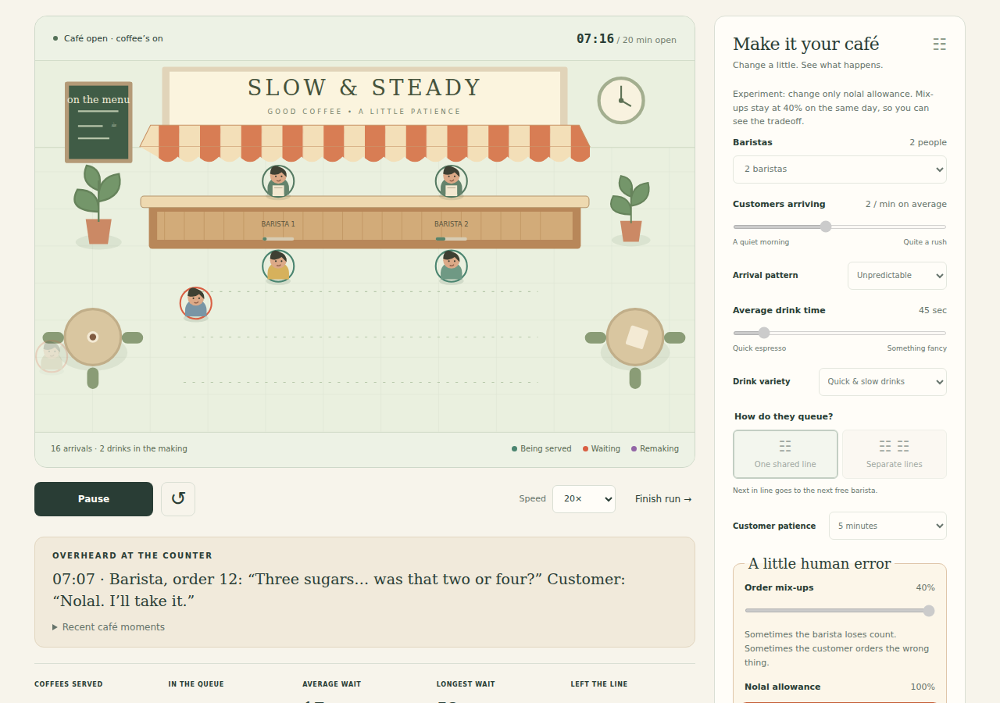

# The Waiting Game

A browser café playground about queues, staffing, patience, and imperfect orders. Open the café, watch its customers, then replay the same demand with a different policy. Four guided experiments introduce queue pooling, capacity, the customers an average can leave out, and the cost of accepting a wrong drink.

[Play the café](https://waiting-game-mothwake.vercel.app) · [Watch the eight-second demo](https://waiting-game-mothwake.vercel.app/demo.html)

[](https://waiting-game-mothwake.vercel.app/demo.html)

## Run locally

Requires Node 22+ for tests; the browser application has no runtime dependencies or build step.

```sh
python3 -m http.server 8080 --directory dist
```

Open http://localhost:8080. Use an HTTP server rather than `file://`, because browsers restrict ES-module loading from files. Simulation, measurements, and session-only history run entirely in the browser. No external fonts, images, trackers, or application network calls.

## Play

- **Open the café:** simulate 20 minutes of arrivals, then finish serving the people who remain.
- Adjust baristas, arrival rate/pattern, drink duration/variety, patience, and queue policy. Edits are staged; **Run these settings** starts a new run.
- Pause, choose 1×/5×/20× speed (20× by default), or finish instantly. Changing controls during playback keeps Pause/Resume available; a separate button starts a new run with those changes. Restart reproduces the current run; the seed control stages new customers until you explicitly start a new run.
- Pin a completed run, then compare another. Matching demand is verified against actual arrival/drink records, not just a seed label. History retains the last six completed runs for the page visit.
- Order mix-ups (0–40%) set how often an order goes wrong. Nolal allowance (0–100%) sets the chance the customer accepts it. Otherwise the same barista makes one replacement. Compare intended drinks, accepted mix-ups, remakes, and time to final drink; watch recent counter stories during playback.
- The first three experiments disable mix-ups and hold demand fixed. The fourth uses 40% mix-ups to compare remaking every wrong drink with accepting it. The staffing experiment starts with a day requiring four baristas; “another day” alternates with a day requiring three. Both use the same expected arrival rate, illustrating variability. Its baseline fails. Other experiments ask you to interpret the measured comparison.

## Model contract

Time is in seconds. Opening interval is `[0,1200)`; the timeline lasts at least 1200 seconds and drains beyond closing when necessary. Steady arrivals begin after the first fixed interval. Unpredictable arrivals have seeded exponential intervals. Service requirements are fixed at the selected mean or a 50/50 mixture of 0.4× and 1.6× that mean. Separate random streams assign arrival, drink requirements, and quality dispositions to each customer before dispatch. Changing staffing, queues, mix-up chance or tolerance never rerolls those dispositions.

Shared queues are FIFO; separate queues choose a shortest line including in-service customers, rotate ties, and never switch lines. Simultaneous events complete service, dispatch waiting customers, expire patience, and process arrivals in ID order, dispatching each. Service offered exactly at the patience deadline wins. Patience never interrupts service, including a remake.

Quality defaults to 15% mix-up chance and 60% acceptance. Half the potential mix-ups are ordering flusters, half barista slips. These are synthetic probabilities, independent of staffing, load and drink time. At first handover, an affected customer either accepts the imperfect drink or requests one guaranteed-correct remake that occupies the same barista for another original drink duration. Nobody rejoins the line. Drink names and sugar counts in the stories are illustrative; they do not change the assigned duration. Supplied test demand without quality dispositions has no mix-ups.

Served means final drink handed over. Intended drinks plus accepted mix-ups equals served. Remakes count when requested, even if still in progress. Arrival-to-final-drink time includes queue, initial service and remake time, and averages only completed customers. Story entries appear only after the corresponding event. The scene clears customer avatars on completion rather than leaving the final departure frozen.

The event engine builds immutable-by-convention customer timelines. Playback samples the timeline and cannot affect model results. Queue-length charts use event-time steps. Animation positions are illustrative; they do not add travel time to service.

Live average and longest wait include customers who have started service. At completion these are exactly the served population. Undefined averages are shown as em dashes. Departures are counted separately with their own mean waiting time. P90 uses nearest-rank. Utilization divides server busy-seconds during opening by server count × elapsed opening time; the final denominator is 1200 seconds per barista, excluding drain time.

This is an educational toy, not a forecast for a real café. No payment, breaks, travel, staff differences, or customer feedback effects are modeled. Individual seeds do not prove universal queue-policy superiority. Scenario constants are synthetic, not measurements.

## Verification

```sh
npm ci
npm run browsers:install
npm test
npm run test:browser
```

The only development dependency is `playwright-core`. Install the matching Chromium with `npm run browsers:install`. On Linux, install system dependencies with `node node_modules/playwright-core/cli.js install --with-deps chromium`. Tests use the locked Playwright version’s Chromium, or `CHROMIUM_EXECUTABLE_PATH` if supplied. Browser tests start an ephemeral localhost server and close it on completion. Screenshots go to ignored `artifacts/`.

Model tests use hand-calculated cases, deterministic replay, simultaneous boundaries, queue dispatch, conservation, validation and challenge feasibility. Browser tests cover actual controls, staged changes, comparisons, all four challenge outcomes, mobile width, keyboard activation, and reduced motion. These checks are not a comprehensive screen-reader audit.

## Source map

- `dist/simulation.js`: pure demand generation, event model and measurements.
- `dist/format.js`: shared readable duration and count labels.
- `dist/challenges.js`: fixed scenarios and measured scoring.
- `dist/app.js`: UI state, playback, comparisons and challenge flow.
- `dist/scene.js`: original SVG café and customer visualization.
- `dist/index.html`, `dist/style.css`: accessible document and responsive presentation.
- `test/`, `browser/`: model and browser tests.
- `docs/verification.md`: model and browser checks.
- `dist/demo.html`, `dist/media/`: a silent eight-second demo and poster.

## Deployment and maintenance

Vercel serves `dist/` as static files using the Other preset, with no install or build command. GitHub CI runs the model and browser tests on Node 22, installs Chromium from the locked Playwright version, checks for source changes and saves screenshots if a check fails. Actions are pinned to commit hashes. Dependabot checks npm and action updates monthly.

The demo is a browser recording: five seconds of a run at 20× speed, followed by three seconds of its completed comparison. It is silent, has playback controls and a text description, and does not load until requested. No stock media or external assets are used.

## License

MIT. Copyright © 2026 mothwake. See [LICENSE](LICENSE).
